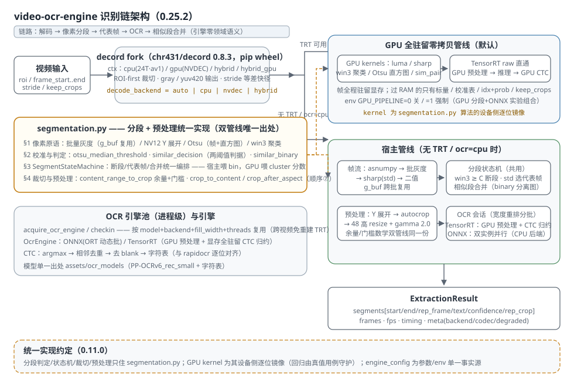

# video-ocr-engine

从视频**固定区域**提取文本的通用引擎：`解码 → 像素分段 → 代表帧 → OCR 文本（含置信度）`。

- **输出只有文本与置信度**——不解析领域含义。速度数字识别、字幕提取、固定字幕条
  OCR 等通用场景直接可用；上层应用自行做数值解析/纠错。
- **零领域语义**：构造参数仅引擎域（`video_path / roi / frame_start / frame_end /
  decode_backend / ocr_backend / buffer_size / fill_width ...`），不含速度/纠错参数。
- **解码器只输出 ROI**（自建 [chr431/decord](https://github.com/chr431/decord) fork 的
  ROI-first 管线），非识别区域不参与转换，显著提速。



*架构图（示意，非规范——事实源 `registry/architecture.yaml`）*

## 安装

### 直接使用源码（推荐）

引擎仓库根目录即 Python 源码根目录，把本目录加入 `PYTHONPATH` / `sys.path` 即可：

```python
import sys
sys.path.insert(0, r"path\to\video_ocr_engine")   # 仓库根目录
from video_ocr_engine import FieldExtractor
```

### pip 安装

```bash
pip install -e .            # 或 pip install .（自带 OCR 模型）
```

Python 3.11+；运行时依赖 `numpy / openvino / psutil`。

### 解码后端（decord fork，必需）

解码使用自建 fork（`chr431/decord`：NVDEC GPU 硬解码、ROI-only 输出、`yuv420`
输出），PyPI 版 decord 不支持。**直接 pip 安装 release wheel**（自带 `decord.dll`
与 FFmpeg 运行库，完全自包含）：

```bash
# 从 chr431/decord 的 Release 取对应 Python 版本的 wheel 后：
pip install decord-<ver>-cp3xx-cp3xx-win_amd64.whl
```

> 硬性要求 FFmpeg 9（不支持 7/8；wheel 已打包运行库）。GPU OCR（TensorRT）
> 另需 CUDA Toolkit + TensorRT 并加入 PATH；不可用时 OCR 自动回退 CPU
> （OpenVINO）。版本矩阵与注意事项见 [docs/DEPENDENCIES.md](docs/DEPENDENCIES.md)。

## 用法

```python
from video_ocr_engine import FieldExtractor

ex = FieldExtractor(
    video_path="subtitle_episode.mkv",
    roi=(10, 850, 1910, 940),        # 字幕条区域 (x1, y1, x2, y2)
    decode_backend="auto",            # auto/cpu/nvdec/hybrid
    ocr_backend="cpu",                # auto/cpu/tensorrt/hybrid
    keep_crops=True,                  # 结果中保留每段代表帧图像
)
result = ex.extract()

print(result.fps)
for seg in result.segments:
    if seg.text:
        print(f"frames {seg.start}-{seg.end}  text={seg.text!r}  conf={seg.confidence:.4f}")
```

构造参数全表（默认值/依据/取舍/入口）见 [docs/KNOBS.md](docs/KNOBS.md)（渲染视图，
事实源 `video_ocr_engine/config/knobs.py`）。

`result` 为 `ExtractionResult`：

| 字段 | 含义 |
|------|------|
| `segments` | `list[ExtractedSegment]`：`start/end/frames/rep_frame/text/confidence/rep_crop` |
| `frames` | 全部采样帧号 |
| `fps` | 自测帧率（从解码器读取，忽略外部传入） |
| `timing` | 各阶段耗时（`decode` / `ocr` / `ocr_tail`） |
| `meta` | `backend / ocr_backend / codec / n_segments / engine_version / params（本次生效参数）/ degraded_reason（降级原因）/ color_range / rep_crop_format` |

> `FieldExtractor` 是**单次提取**对象：`extract()` 每次全量重跑（重新打开解码器/
> 校准/取 OCR 引擎）并覆盖实例状态；**结果唯一读面是返回值**。批量多视频请各建
> 实例（见"批量处理"）。

**解码后端选型**：长片（全识别范围）三编码一律 `hybrid` 最快（依据与换机复评
条件见 C-05/C-53）；`auto` 恒为 NVDEC 优先、不按编码分流（刻意决策，C-08）；
`cpu` 与 `nvdec` 孰快是**文件相关而非码级规则**（同编码不同片源差异显著，按格式
猜会错）——批量场景按实测速率分派。下"谁更快"的结论必须用 `tools/bench.py ab`
的交错配对口径。**`ocr_backend="hybrid"`（TRT+OpenVINO 双车道）是 OCR-bound 实验
组合，实测无净收益、勿用于生产**（C-58/C-60）。

> `decode_backend="hybrid"` 由 decord fork 原生实现：同一实例内 NVDEC 与 CPU
> 软解并行，分片与负载调度在 fork 内完成（参数面与 `cpu`/`nvdec` 一致，含
> `sample_stride`）；打开失败自动降级（`meta.degraded_reason` 有记录）。CPU 分片
> 线程档与 `cpu` 后端共用同一 codec 感知策略，可用 `HYBRID_CPU_THREADS` 显式覆盖。

> `rep_crop` 像素格式由 `rep_crop_format` 决定：`"yuv"`（默认）= packed NV12，
> 用 `video_utils.nv12_to_rgb` 或 `result.rep_crop_rgb(seg)` 转 RGB 预览；
> `"gray"` = 灰度。引擎内部链恒为单通道灰度（RGB→灰度在解码侧完成）。不需要
> 预览图时设 `keep_crops=False` 可显著降内存。

## 分频采样（sample_stride 参数）

`FieldExtractor(sample_stride=N)`（默认 1）：`>1` 时只解码/分段/OCR 每个第 N 帧——
字幕等 ROI 更新较慢时显著降低处理压力，时间戳仍取真实帧号（准确度基本不变）。
依赖 decord fork 的 `GetBatch` 等差步长快速路径（版本要求见
[docs/DEPENDENCIES.md](docs/DEPENDENCIES.md)）。`stride=1`（默认）保持完全兼容
（零改动）。

> 长视频/大 ROI 且不需要预览图时，`keep_crops=False`、`keep_frames=False` 可
> 显著降低内存占用（默认 `True` 保持兼容）。注意 `keep_frames=False` 同时清空
> **段级** `frames` 序列（仅保留 `start/end/rep_frame`），依赖"段→帧区间"的
> 下游会拿到空序列。

> 面向字幕提取的完整 CLI 应用已拆到独立仓库
> [chr431/video_subtitle_extractor](https://github.com/chr431/video_subtitle_extractor)：
> 提供 `--roi`/`--start-frame`/`--end-frame`/`--sample-stride` 等参数，输出
> `time_sec,text` 两列 CSV。本引擎仓库保持为通用引擎（不携带具体场景 CLI）。

## 批量处理（多集/多视频）

**推荐：逐文件顺序跑 + `decode_backend="hybrid"`**——单 NVDEC 硬件单元上跨视频
并发不提供增益、只增加争用（机制结论见 C-01/C-53）：

```python
results = []
for kw in items:                       # 逐文件顺序跑
    kw = {**kw, "decode_backend": "hybrid"}
    results.append(FieldExtractor(**kw).extract())
```

**显式预热**（可选）：把 OCR 引擎构建的一次性成本挪到调用方选定的时刻——不改变
总吞吐（只是把成本提前），也不自动触发；服务"要连跑多个视频 / 需要稳定首帧延迟"
的场景（依据见 C-36）：

```python
ex = FieldExtractor(...)
ex.warmup()          # 把一次性成本挪到此刻
ex.extract()         # 首个 extract 的引擎初始化成本大幅下降
```

批量循环前对**任意一个**实例调一次即可（引擎池按"模型/引擎类型/pad 下限/线程数"
共享）。

> 实例相互独立（各自 OCR 会话/TRT 上下文共存正常）。若确需并发：互补配对
> （一侧 `decode_backend="cpu"` 显式指定）的机制结论见 C-01——注意 `"auto"`
> 恒为 NVDEC 优先（C-08），指望它自动配成 CPU 解码无效；跑完可用
> `FieldExtractor._backend` 核验实际后端。少核机器收益递减，先小规模试测。

> **遥测（默认关闭）**：`VOE_TELEMETRY=full` 开启后 `result.meta["report"]` /
> `result.report`（类型化只读视图）带相位耗时、计数器、健康判定、环境指纹与
> 资源段；`VOE_REPORT_FILE=<path>` 把细档 JSON 落盘并启用崩溃/停顿现场转储
> （挂死时是唯一现场）。字段与档位见 `video_ocr_engine/pipeline/report.py` 与
> [docs/KNOBS.md](docs/KNOBS.md)。

## 识别链

`校准 → 分段（ROI 灰度逐帧异或 + 3×3 聚类）→ 代表帧（段内清晰度最大）→ OCR
（resize + gamma → PP-OCRv6）`；NVDEC + TensorRT 可用时默认走**显存全驻留零拷贝**
管线。实现单一出处 = `video_ocr_engine/domain/segmentation.py`（C-32）；链路与
GPU 管线的现状描述（渲染视图）见 [AGENTS.md](AGENTS.md) 与
`registry/architecture.yaml`。

### 性能参考（2026-10-14，RTX 4060M / 16C32T / TRT OCR）

test6 全片（23970 帧，1080p，字幕 ROI 106×33，`tools/bench.py run` 3 轮中位）：

| 编码 | nvdec | cpu | hybrid | 最快 |
|---|---|---|---|---|
| h264 | 25.4s | 8.85s | **8.12s** | hybrid |
| hevc | 11.6s | 22.4s | **8.22s** | hybrid |
| av1 | 13.9s | 17.6s | **8.63s** | hybrid |

长片三编码一律 hybrid 最快（C-05/C-53）；NVDEC+TRT 的零拷贝管线在采样窗口
内的短跑与逐段对比上与宿主 lane 等效或更快（C-84）。数字高度依赖硬件与
片源——自测请用 `tools/bench.py`（交错配对口径，内置后台负载与 GPU 时钟门禁）。

## 环境变量钩子

> 构造参数已覆盖绝大多数用法；环境变量仅在**批量调优/诊断**时使用。
> 未设置 = 引擎默认值（已按实测调优）。

**优先级**：同一旋钮多入口时按 **显式构造参数 > env > 引擎默认值** 生效。
**生效时机**：env 在**构造期一次解析并冻结**——构造之后再改 env 不再生效，批量
调参须新建实例（`DECORD_SKIP_LOOP_FILTER` 例外，由 decord 在打开解码器时读取）。
部分旋钮仅 env 入口（无构造参数承接）——全表、入口与依据见
[docs/KNOBS.md](docs/KNOBS.md)（事实源 `video_ocr_engine/config/knobs.py`）。

## 文档

制度分层：宪章（不变量）→ registry（唯一事实源）→ 执行（CI+本机门禁）→ 视图（全渲染）→ git（唯一档案）。

- [现役结论索引](docs/CONCLUSIONS.md) —— **动手前先查**：每条结论带前提与复评触发（渲染产物；事实源 `registry/conclusions.yaml`）。
- [旋钮表](docs/KNOBS.md) / [依赖与运行环境](docs/DEPENDENCIES.md) —— 渲染视图（事实源分别为 `config/knobs.py` 与 pyproject+registry）。
- `charter.md` / `registry/` —— 制度不变量与唯一事实源（yaml）。
- `AGENTS.md` —— 维护者向**注入核**（渲染产物：宪章 + registry 快照；上限 6KB）。
- [`tools/INDEX.md`](tools/INDEX.md) —— standing 工具与在树探针清单（渲染产物）。

## 测试

```bash
pip install -e ".[dev]"
python tools/check.py --tier release   # 两级链：lint/类型/单测/守卫/金标/清扫/KPI
python tools/check.py                  # 日常（迭代默认）
```

纯单元测试无需视频 / decord / GPU（OCR 用例用 OpenVINO CPU + 仓库内模型）；
金标与端到端验收需真值视频（经 `RACELOG_VIDEO_DIR` 指定），无视频环境自动 SKIP
并显式标注。

### 端到端冒烟（真实视频）

`tools/e2e_smoke.py`：同一视频窗口跑配置矩阵（GPU 零拷贝 / 灰度 raw / keep 关闭 /
宿主+TRT / CPU / hybrid），校验跨路径文本一致性、代表帧格式、段序/置信度，可对照
ground-truth CSV 验证匹配率，并可重复跑测墙钟与分相耗时。示例：

```bash
# 功能矩阵 + 真值验证（ROI/帧区间可自动从 truth CSV 头读）
python tools/e2e_smoke.py --video <视频> --roi 843,993,948,1025 \
    --truth <truth.csv> --frames 5000 --stride 8 --verify

# 只探元数据；性能测试（重复跑 + ENGINE_PROFILE）
python tools/e2e_smoke.py --video <视频> --roi 843,993,948,1025 --probe
python tools/e2e_smoke.py --video <视频> --roi 843,993,948,1025 --perf --runs 3
```

运行 GPU 路径需 decord fork（ROI-first / GPU gray / yuv420）、`cuda-python`
（分段/校准/CTC kernel）与 TensorRT thin binding（DLL 从系统 PATH 加载）。

## 许可证

**Apache-2.0**。本引擎是独立通用库：不依赖 Qt/GUI 组件，无 copyleft 传染，
可自由用于开源与商业项目（其依赖 decord / PP-OCRv6 亦为宽松或兼容许可）。
